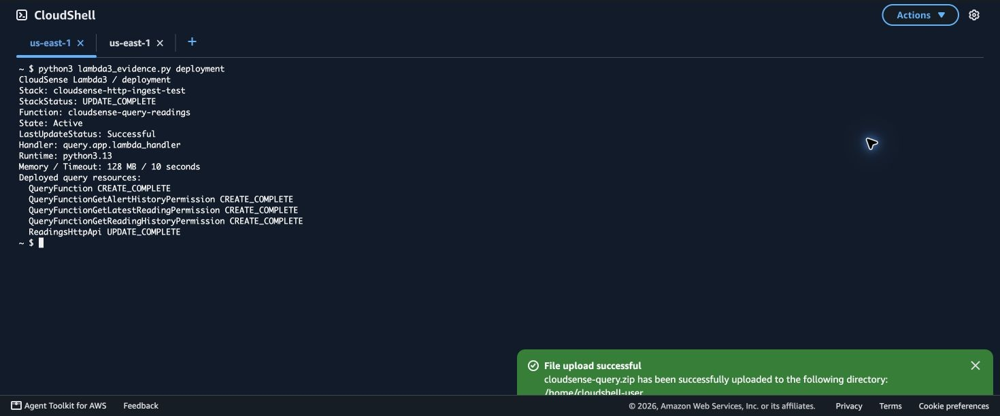

# Lambda3：Dashboard 查询 API

Lambda3 从 Lambda2 已写入的 DynamoDB 读取数据，供 Dashboard 展示。

实现与部署流程见本文；逐项测试步骤、实际结果及截图见 [QueryLambda_test.md](QueryLambda_test.md)。

```text
模拟函数 -> POST /readings -> Lambda1 -> SQS -> Lambda2 -> DynamoDB
网页 -> GET /devices/{device_id}/... -> API Gateway -> Lambda3 -> DynamoDB
```

## 文件与配置

实际项目目录为 `cloudsense/`，本次未修改旁边的 `CloudSense-main/` 副本。

| 文件 | 内容 |
| --- | --- |
| `cloudsense/src/query/app.py` | 查询 Lambda，Handler 为 `query.app.lambda_handler` |
| `cloudsense/template.yaml` | Lambda3、三个 GET 路由、API CORS 和部署输出 |
| `cloudsense/tests/test_query.py` | 查询与现有存储格式兼容、分页、分类、参数和错误处理测试 |
| `cloudsense/events/query_latest.json` | Lambda 控制台测试事件 |
| `cloudsense/scripts/package_query.py` | 生成独立 ZIP |
| `cloudsense/README.md` | 完整接口说明和调用示例 |

Lambda 名称为 `cloudsense-query-readings`，Python 3.13，128 MB，超时 10 秒。

- `ALERT_STATE_TABLE`：现有 DynamoDB 表名。
- `DATA_STALE_SECONDS`：默认 300；超过此测量年龄，最新接口返回 `is_stale: true`。
- 执行角色复用 Learner Lab 现有 `LabRole`；需要表索引的 `dynamodb:Query` 权限。
- `DashboardAllowedOrigins`：API Gateway 的允许来源，默认 `http://localhost:5173`。

## 三个接口

| 接口 | 功能 |
| --- | --- |
| `GET /devices/{device_id}/latest` | 最新测量、各参数状态、整体状态、异常项、数据年龄及过期提示 |
| `GET /devices/{device_id}/history` | 按设备和测量时间查询历史数据，从新到旧 |
| `GET /devices/{device_id}/alerts` | 查询有 Warning 或 Critical 指标的历史读数 |

使用现有 `DeviceTimeIndex` 索引：

```text
GSI1PK = DEVICE#<device_id>
GSI1SK = <20 位补零测量 epoch>#<reading_id>
```

Lambda3 使用 `Query`，不会扫描全表、写入读数或发送邮件。
测试脚本为独立核对接口结果，曾只读扫描测试表来取得预期结果；这不是 Lambda3 的查询方式。

历史与异常接口支持：

- `from`、`to`：带时区、精确到整秒的 ISO 8601 时间，包含起止时间。
- 不传时间时默认最近 24 小时；若传 `to`，默认从 `to` 往前 24 小时。
- `limit`：1–100，默认 50，限制本次 DynamoDB 评估的读数数量。
- `next_token`：下一页游标；保持原设备、接口及时间参数，直到返回 `null`。

异常接口按每条读数返回，异常参数在 `alerts` 数组中。
一页可能没有异常项，但仍有 `next_token`，前端需要继续翻页。

查询结果包含：

```json
{
  "reading": {"device_id": "dev-001", "reading_id": "..."},
  "evaluations": [{"metric": "spo2_pct", "level": "critical", "message": "..."}],
  "overall_status": "critical",
  "alerts": [{"metric": "spo2_pct", "level": "critical", "message": "...", "notification_status": "CRITICAL_PENDING"}],
  "processing_status": "COMPLETE",
  "is_late": false,
  "measured_at_epoch": 1793361600,
  "updated_at": 1793361601
}
```

最新接口将上述对象放在 `data` 中，另有 `device_id`、`age_seconds`、`is_stale`。
列表接口将对象放在 `items` 中，另有 `device_id`、`from`、`to`、`count`、`next_token`。

`overall_status` 取已保存指标中的最高异常等级；缺少分类时为 `unknown`。
`notification_status` 表示邮件处理决定，不能代替身体指标的异常等级。
例如首条 Critical 可能还在等待连续第二次确认，等级仍为 Critical。
迟到测量与邮件被冷却抑制的异常数据也会保留，供历史查询。
当前保存的说明是指标数值与等级，没有额外保存规则版本或阈值快照。

## 前端调用

从 CloudFormation 输出获取 `QueryApiBaseUrl`。示例：

```javascript
const baseUrl = "<QueryApiBaseUrl>";
const deviceId = "email-critical-001"; // 已有模拟数据的设备

async function fetchLatest() {
  const response = await fetch(
    `${baseUrl}/devices/${encodeURIComponent(deviceId)}/latest`
  );
  if (!response.ok) throw new Error(`Query failed: ${response.status}`);
  return response.json();
}

// Dashboard 可每 3–5 秒调用一次；处理 is_stale、404 和网络错误。
```

前端注意：

1. 根据 `evaluations` 给各指标卡片着色，根据 `overall_status` 显示整体等级。
2. 根据 `alerts` 展示异常参数和说明；同一条 `reading_id` 不重复弹窗。
3. 根据 `is_stale` 提示数据停止更新；保留原有测量等级供查看。
4. 历史结果从新到旧，画时间折线图时需按时间升序排列。
5. GSI 最终一致，新数据或告警处理状态可能稍后出现，可在下一次轮询刷新。
6. 异常历史不是“已确认/已恢复”事件管理系统，当前没有确认或关闭异常的写入接口。

## 本地验证与打包

```bash
cd cloudsense
python3 -m pytest -q tests
ruff check src tests simulator scripts/package_query.py
python3 scripts/package_query.py
```

本次本地结果：`75 passed, 4 subtests passed`；Ruff 检查通过。
已检查 SAM YAML 的三个查询路由和索引引用。
本机没有 SAM CLI，因此未在本机执行 `sam validate`；云端 CloudFormation 变更集已成功处理 SAM 并完成部署。

ZIP：`cloudsense/dist/cloudsense-query.zip`，仅包含 `query/__init__.py` 和 `query/app.py`。

```text
SHA-256: 17c6dc6cf27153a450cec595a997ca93466d0cc1de3d04f54f893e96ca904c39
```

## 云端部署与历史数据实测（2026-11-06）

在用户已打开的 Chrome AWS Academy Learner Lab 中，通过 CloudShell 完成。
区域为 `us-east-1`，已有 Stack 为 `cloudsense-http-ingest-test`。

为保留当前 Lambda1、Lambda2 的已部署版本，本次从云端已有的 Original 模板出发，
保留所有原资源及 CodeUri，再加入本地配置中的 QueryFunction、CORS 参数和查询输出。
ZIP 上传到现有 SAM 部署制品桶，创建并审查变更集 `add-dashboard-query-20261106`。

变更集仅包含：

- 新增 `QueryFunction`。
- 新增三个 QueryFunction API 调用 Permission。
- 原地更新 `ReadingsHttpApi` 的查询路由与 CORS，无资源替换。

执行后 Stack 状态为 `UPDATE_COMPLETE`。

### 本次部署的复现步骤

1. 在本地 `cloudsense/` 运行 `python3 scripts/package_query.py`，得到 ZIP 并核对上述 SHA-256。
2. 在 AWS Console 选择 `us-east-1`，打开 CloudShell，通过 **Actions → Upload file** 上传 ZIP 到 CloudShell 主目录。
3. 将本文件夹 `scripts/` 内的部署脚本放到 CloudShell。脚本通过当前 Lab 会话获取权限，无需将访问密钥写入项目。
4. **仅当旧 Stack 尚未包含 QueryFunction 时**，运行 `python3 prepare_deployment.py`。该脚本读取已有 Original 模板、保留原 CodeUri、上传 ZIP 至已有制品桶并创建变更集。脚本内的 ZIP 哈希、Stack 和变更集名称是本次实验的固定值；代码或环境变化时需先核对并更新。
5. 查看变更集，确认只新增 QueryFunction 和三个 Permission，并原地修改 ReadingsHttpApi。运行 `python3 execute_reviewed_changeset.py`；脚本会再次核验允许的变更范围后执行。
6. 在 CloudFormation 等待 Stack 达到 `UPDATE_COMPLETE`，再执行测试文档中的只读验证。

这是对**现有 Lab Stack 的一次增量部署记录**。当前已部署完成，不应重新运行首次创建脚本；再次更新应使用新变更集并检查差异。新的完整项目环境可使用 `cloudsense/template.yaml` 走常规 SAM 构建部署流程。



通过实际 HTTP 请求与 DynamoDB 原始记录比较，结果为 PASS：

| 测试设备 | 历史读数匹配数量 | 异常读数匹配数量 | 最新读数匹配 |
| --- | ---: | ---: | --- |
| dev-l2-e2e-critical | 2 | 2 | 通过 |
| dev-l2-e2e-warning | 1 | 1 | 通过 |
| dev-l2-warning-final | 1 | 1 | 通过 |
| dev-lambda2-critical | 1 | 1 | 通过 |
| dev-lambda2-warning | 2 | 2 | 通过 |
| email-critical-001 | 2 | 2 | 通过 |
| email-warning-001 | 2 | 2 | 通过 |

合计核对 7 个设备、11 条既有模拟读数；数值、各指标等级、整体等级与告警处理状态均匹配。
测试范围包含测量时间起止边界、分页、不存在设备、非法参数与 CORS OPTIONS 预检。
既有数据为旧测量，最新接口正确返回 `is_stale: true`。

## 新数据链路测试的当前阻塞

补测正常模拟数据时，`POST /readings` 返回 202，但查询未出现新记录。
只读排查发现 `cloudsense-process-alerts` 的 SQS Event Source Mapping 为 `Disabled`；
主队列有 1 条可见消息、0 条处理中消息，DLQ 为 0，DynamoDB 尚无该 reading。
因此本次已证明 Lambda3 能正确读取已存数据，**尚未证明新数据可经过当前整条链路实时写入并被查询**。

测试设备：`query-demo-20261106`；reading_id：`2ad07287-b2e0-4cf3-9c79-180139d8fc89`。
这条正常样本留在队列中，本次没有更改 Lambda2 触发器，也没有清空队列。
后续恢复 Lambda2 消费后，应重新执行新数据验证；旧样本可能因时间已久而正确显示 stale，实时性应以新的时间戳验证。

## 使用边界

目前查询 API 和现有采集 API 一样，没有登录授权器；仅用于本项目的模拟数据实验。
CORS 不是访问鉴权。后续若接入真实私人健康数据，需要加入登录及设备归属校验。
历史保存期限由 Lambda2 的配置控制，当前默认 90 天。
