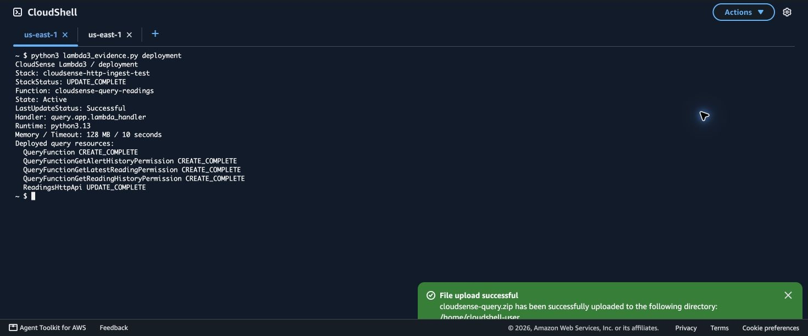
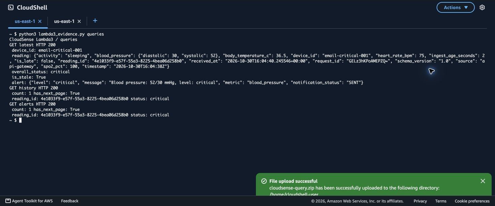
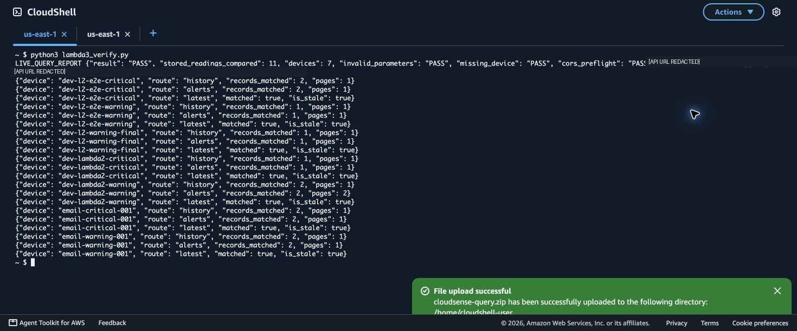
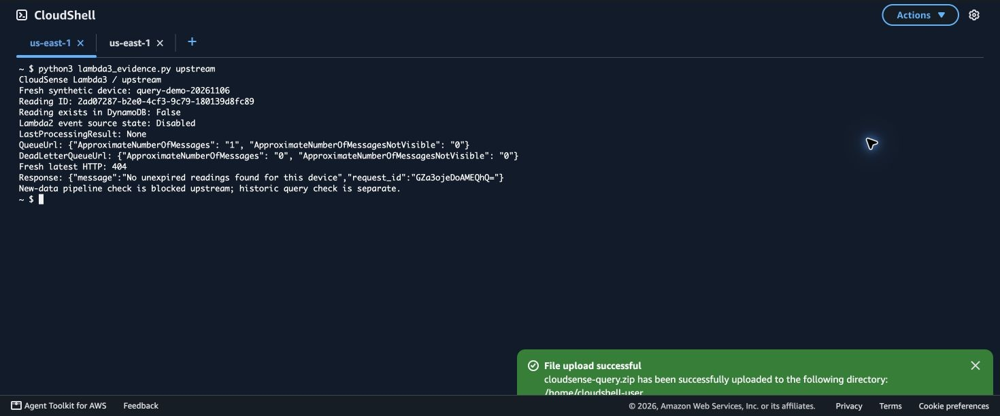

# Lambda3 测试复现与截图

## 1. 结论与环境

2026-11-06，在 AWS Academy Learner Lab、`us-east-1`、Stack `cloudsense-http-ingest-test` 实测。
Lambda3 已部署为 `cloudsense-query-readings`，三个 GET 接口均成功读取现有 DynamoDB 模拟数据。
7 个设备共 11 条读数与数据库原记录匹配。本地测试为 `75 passed, 4 subtests passed`。

新增正常样本的整条链路测试受到上游阻塞：Lambda2 的 SQS 触发器处于 `Disabled`。
因此应把“Lambda3 已存数据查询通过”和“新数据整条链路未完成”分开记录。

## 2. 文件索引

| 文件 | 用途 |
| --- | --- |
| [QueryLambda.md](QueryLambda.md) | 架构、代码位置、API 契约、前端接入与部署流程 |
| [scripts/prepare_deployment.py](scripts/prepare_deployment.py) | 本次首次增量部署时实际运行的准备脚本；创建变更集，不直接执行 |
| [scripts/execute_reviewed_changeset.py](scripts/execute_reviewed_changeset.py) | 校验变更范围并执行变更集；当前已经执行，无需重复 |
| [scripts/verify_live_queries.py](scripts/verify_live_queries.py) | 只读比对实际 HTTP API 与 DynamoDB 原记录 |
| [scripts/inspect_deployment.py](scripts/inspect_deployment.py) | 只读查看部署、响应与新数据上游阻塞 |
| `pic/` | 本次 AWS CloudShell 实际运行截图 |

部署脚本固定了本次 Stack 名称与 ZIP 哈希，适用于已有旧版 Stack 的首次新增 Lambda3。
不要在已经部署完成的 Stack 上原样重新执行部署脚本。查询检查脚本可以重复执行。

## 3. 本地测试与打包

在项目根目录执行：

```bash
cd cloudsense
python3 -m pytest -q tests
ruff check src tests simulator scripts/package_query.py
python3 scripts/package_query.py
```

本机测试使用已安装 pytest 的 Anaconda Python；系统 Python 缺少 pytest。
Ruff 与 `git diff --check` 通过。没有本地 SAM CLI，因此未宣称本地 `sam validate` 通过；
实际 CloudFormation 变更集完成 SAM 转换且 Stack 达到 `UPDATE_COMPLETE`。

本地自动测试包括：原存储格式、数值序列化、最高等级、邮件状态、时间边界、TTL 过滤、
空页与分页游标、跨设备/接口游标拒绝、过期提示、非法参数和数据库故障响应。

打包结果：`cloudsense/dist/cloudsense-query.zip`，只包含 `query/__init__.py`、`query/app.py`。
SHA-256：`17c6dc6cf27153a450cec595a997ca93466d0cc1de3d04f54f893e96ca904c39`。

## 4. 云端部署验证

打开 Chrome 中的 AWS Console → CloudShell，确认区域 `us-east-1`。
将 `scripts/inspect_deployment.py` 放入 CloudShell 当前目录，运行：

```bash
python3 inspect_deployment.py deployment
```

截图采集时脚本在 CloudShell 中保存为 `lambda3_evidence.py`，对应命令为：

```bash
python3 lambda3_evidence.py deployment
```

预期与实际结果：

| 项目 | 实际结果 |
| --- | --- |
| StackStatus | `UPDATE_COMPLETE` |
| Function State | `Active` |
| LastUpdateStatus | `Successful` |
| Handler | `query.app.lambda_handler` |
| Runtime | `python3.13` |
| QueryFunction 及三个调用 Permission | `CREATE_COMPLETE` |
| ReadingsHttpApi | `UPDATE_COMPLETE` |



## 5. 三个接口人工检查

```bash
python3 inspect_deployment.py queries
```

脚本从 Stack 输出自动读取 API 地址，对已有设备 `email-critical-001` 调用：

```text
GET /devices/email-critical-001/latest
GET /devices/email-critical-001/history?from=2026-10-01T00:00:00Z&to=2026-11-07T00:00:00Z&limit=1
GET /devices/email-critical-001/alerts?from=2026-10-01T00:00:00Z&to=2026-11-07T00:00:00Z&limit=1
```

三个请求均返回 HTTP 200。最新读数整体等级为 `critical`，异常指标为 `blood_pressure`，
说明为 `Blood pressure: 52/30 mmHg, level: critical`，邮件决定为 `SENT`。
旧测量的 `is_stale: true` 正确表示数据已停止更新；不代表将原 Critical 等级改为 Normal。
历史及异常接口在 `limit=1` 时各返回一条，并提供下一页游标。



## 6. 数据库与 HTTP API 自动比对

将 `scripts/verify_live_queries.py` 放入 CloudShell，执行：

```bash
python3 verify_live_queries.py > lambda3-query-verification.log
cat lambda3-query-verification.log
```

脚本用只读 Scan 取得数据库中的未过期 DATA 记录作为独立预期结果，随后调用实际 HTTP 接口。
Lambda3 自身仍使用 `DeviceTimeIndex` 的 Query，不使用 Scan。
脚本不会向 SQS 写消息、不会调用 SNS、不会修改 DynamoDB。

逐设备验证最新读数、历史顺序、异常筛选、全部原始数值、指标判断、最高等级、邮件处理状态、
含端点的时间窗口以及游标翻页。额外验证：

| 用例 | 预期与实际结果 |
| --- | --- |
| `limit=101` | HTTP 400 |
| 非法 `from` | HTTP 400 |
| 非法 `next_token` | HTTP 400 |
| 不存在设备的 latest | HTTP 404 |
| 不存在设备的 history | `items: []` |
| localhost:5173 的 OPTIONS 预检 | HTTP 204，Allow-Origin 正确 |
| 既有旧测量 | `is_stale: true` |

设备与数量详见 [实现文档的实测表](QueryLambda.md#云端部署与历史数据实测2026-11-06)。
本次结果 `LIVE_QUERY_REPORT` 为 `PASS`、`stored_readings_compared: 11`、`devices: 7`。
截图采集时使用同一套断言，将长报告分行输出以便阅读；CloudShell 中脚本名为 `lambda3_verify.py`。
后续表内数据或 TTL 改变时，复测数量可能变化；预期数量由当时的数据库内容计算。



## 7. 新正常样本测试：上游阻塞

本次补测实际发送了一条正常模拟读数到已有 `POST /readings`：

| 项目 | 内容 |
| --- | --- |
| device_id | `query-demo-20261106` |
| reading_id | `2ad07287-b2e0-4cf3-9c79-180139d8fc89` |
| 心率 / 体温 / SpO2 | 78 bpm / 36.7 °C / 98% |
| 血压 | 118/76 mmHg |
| POST 结果 | HTTP 202 |
| 轮询 latest | 未出现该读数 |
| DynamoDB GetItem | 无该记录 |
| Lambda2 SQS Mapping | `Disabled` |
| SQS 主队列 / 处理中 / DLQ | 1 / 0 / 0（近似计数） |

只读复查：

```bash
python3 inspect_deployment.py upstream
```



202 表示采集请求已接受，不代表 Lambda2 已完成分类和存储。
目前证据说明新数据在 Lambda2 消费前受阻；不能把这个结果写成 Lambda3 查询错误，
也不能宣称整条新数据链路已经成功。
本次保留原触发器状态和队列中的正常样本，未手动伪造数据库记录来通过测试。

后续恢复 Lambda2 SQS 消费时，应先核对队列内容，再恢复触发器；队列消息会进入原有分类和通知流程。
随后用当前时间戳发一条新的正常样本，确认 DynamoDB 有记录、latest 返回相同 reading_id、
`overall_status=normal`、`is_stale=false`，且 history 可见、alerts 不包含该读数。
这一步是后续待完成项，本次没有执行触发器恢复。

## 8. 截图说明

截图来自本次真实 AWS CloudShell 命令及响应；测试结果未重绘。
截图保留 CloudShell 页名、区域和命令上下文，裁去顶部账号栏；实际 API 地址已用明确的脱敏标记遮盖。
本目录包含模拟数据及实验环境信息，未保存 AWS 凭证。
数据库比对脚本的汇总报告现使用 `<QueryApiBaseUrl>` 占位符，不再打印实际基础地址，方便安全截图。

## 9. 不打开 CloudShell 的本机测试

GitHub 仓库根目录新增 `LOCAL_TESTING.md`，包含虚拟环境安装、离线单元测试、
直接调用查询 API 和可选的本机 AWS SDK 数据比对步骤。
仓库根目录 `scripts/test_query_api.py` 只使用 Python 标准库，无需 AWS 凭证：

```bash
python3 scripts/test_query_api.py \
  --base-url 'https://<api-id>.execute-api.us-east-1.amazonaws.com' \
  --device-id email-critical-001 \
  --from 2026-10-01T00:00:00Z \
  --to 2026-11-07T00:00:00Z
```

2026-11-06 已从本机直接访问已部署 API，latest/history/alerts 均返回 HTTP 200，
history 和 alerts 各返回 2 条已有读数；无需打开 CloudShell。
再次运行全部本地单元测试为 `75 passed, 4 subtests passed`。
